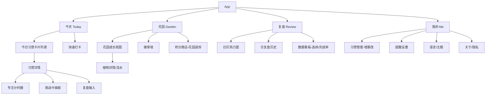
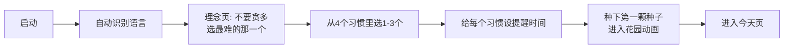
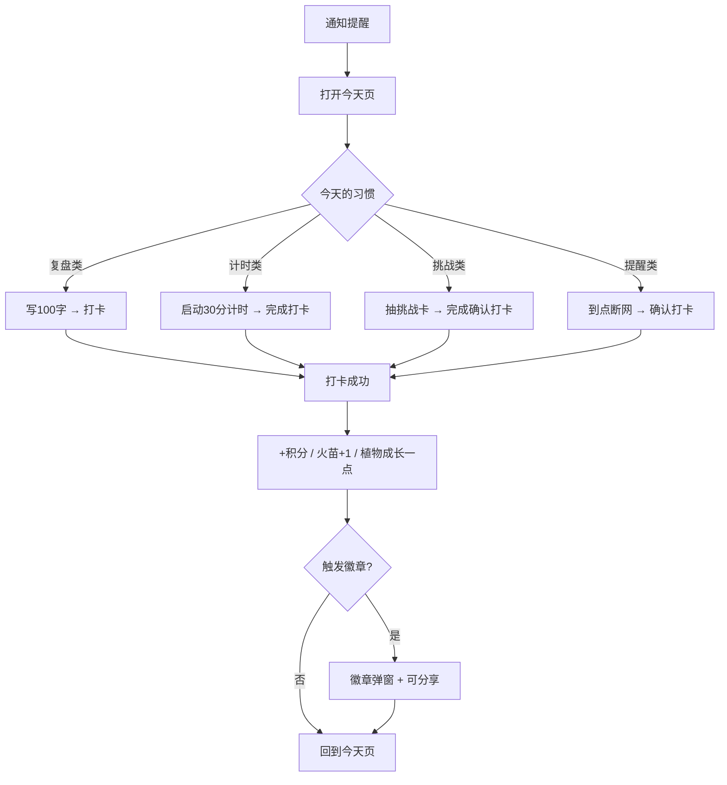
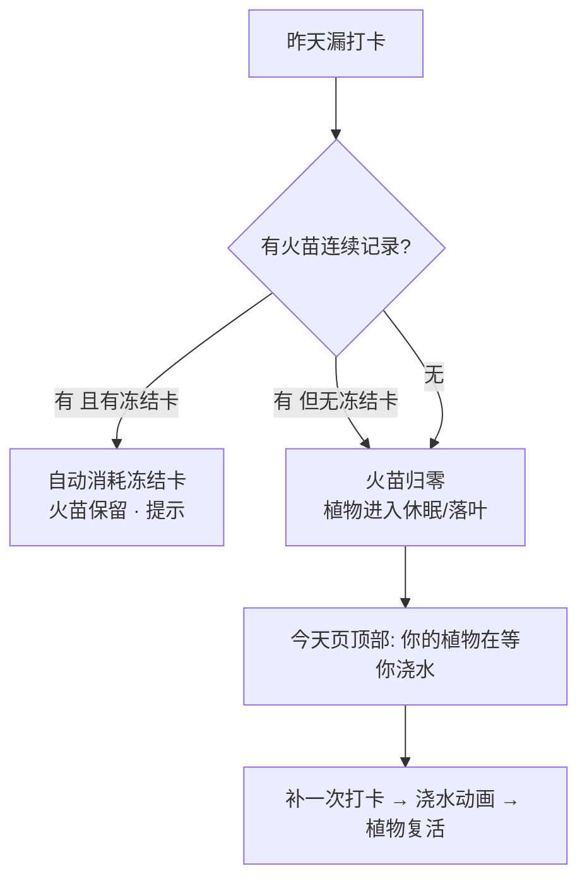
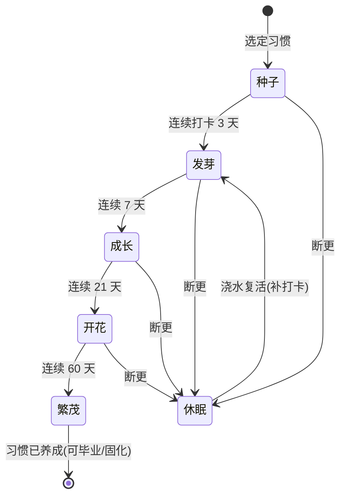

# 习惯养成 App —— 产品设计文档(MVP)v0.1

> 技术栈已定:**Flutter**(iOS+Android 双端先)。数据本地优先无后端。
> 本文档是开发前的设计蓝图:MVP 范围 → 信息架构 → 页面流程 → 交互细节 → 花园状态机 → 数据模型。
> 面向设计师视角,视觉留白给你发挥,交互逻辑先钉死。

---

## 一、MVP 范围(先做什么)

**原则:用最小功能验证"核心循环 + 花园 + 奖励"跑不跑得通,再谈扩张。**

### MVP 首发的 4 个习惯(覆盖 4 类交互)

| 习惯 | 交互类型 | 验证的能力 |
|---|---|---|
| ① 每天100字复盘 | **记录/文本** | 复盘模板、日记式输入 |
| ③ 30分钟深度思考 | **计时/专注** | 计时器、免打扰、完成即打卡 |
| ⑥ 每天一件微不适的事 | **挑战/一次性动作** | 挑战卡池、抽卡、完成确认 |
| ⑨ 睡前断网仪式 | **提醒/时间触发** | 定时通知、就寝模式 |

> 这 4 个覆盖了"文本输入 / 计时 / 抽卡 / 定时提醒"四种最典型的习惯交互。核心 loop 通了,剩下 8 个习惯都是这几种模式的变体,扩张很快。

### MVP 功能清单

**做**:引导(Onboarding)、今日页、习惯打卡、专注计时器、挑战卡、就寝提醒、日复盘、花园(成长+休眠+浇水复活)、火苗streak+冻结卡、徽章墙、积分、日历热力图、5语言、本地通知、本地数据。

**不做(放后续)**:旅行攻略、无限画板、读书分享、AI教练、周财务盘点、弱关系转盘、云同步、账号、社区、鸿蒙、国内渠道。

---

## 二、信息架构(导航 + 页面树)

底部 4 个 Tab,二级页面挂在下面。



- **今天**:用户 90% 时间待的地方。只显示"今天要做的",减少决策负担。
- **花园**:奖励与情感联结中心,主打视觉与分享。
- **复盘**:回顾与数据,长期成就感来源。
- **我的**:配置区,低频。

---

## 三、核心用户流程

### 3.1 首次引导(Onboarding)



> 引导最后一步"种下种子"很关键——第一次就给情感锚点和即时反馈,让用户带着一株刚种下的植物进入产品。

### 3.2 每日核心循环



### 3.3 断更与挽回(留存命门)



> **不"枯死"、可复活**是刻意设计。惩罚温和,回流路径短,是习惯类App留存的核心差异点。

---

## 四、逐屏设计要点

### 今日页(Today)
- 顶部:今天日期 + 一句激励(取自12习惯文案,5语言)+ 花园缩略入口
- 主体:今日习惯卡片(每张显示 习惯名 / 当下动作按钮 / 火苗天数 / 完成态)
- 卡片按钮直接是"当下动作":复盘类→"写复盘",计时类→"开始30分",挑战类→"抽今日挑战",提醒类→到点亮起"我断网了"
- 底部:今日完成进度(如 2/3)

### 专注计时器
- 全屏、极简、深色护眼;大号倒计时
- 引导语:"把手机放到另一个房间"(呼应习惯3文案)
- 中途退出确认;完成后弹"写一句今天想清楚了什么"→ 打卡

### 挑战卡
- 抽卡动效(卡池:举手发言/拒绝一个请求/赞美陌生人…,5语言,可扩展)
- 一天一抽;完成点"我做到了"→ 打卡 + 特殊徽章累计
- 可"换一张"(每天限1次),降低"抽到做不到"的挫败

### 就寝模式
- 设定断网时刻;到点全屏"断网时间到"+柔和引导
- 用户确认"我放下手机"即打卡(诚信机制,不强制锁机)
- 可选:显示斯坦福睡眠数据小科普(习惯9文案)

### 日复盘
- 模板三段:**今天做了什么决定 / 结果怎样 / 下次怎么改**(习惯1结构)
- 100字进度提示;历史可翻阅;支持给复盘打情绪标签

### 花园页
- 主视觉:你的习惯们长成的一片花园;每个习惯 = 一株植物
- 植物阶段随连续天数推进;休眠植物有"浇水"呼吸提示
- 切到徽章墙 / 积分商店(装饰、稀有植物皮肤)

### 复盘Tab-数据
- 日历热力图(打卡浓淡)、连续天数、完成率、每习惯趋势

---

## 五、花园成长状态机

每株植物(= 一个习惯)的生命周期:



- 阶段阈值(3/7/21/60)可调,先用这套(21天/习惯养成 的通俗心理预期)
- **休眠不倒退到种子**,复活回到"发芽",保护用户既有投入
- "繁茂/毕业"给长期用户一个终点仪式感,并引导他解锁下一个习惯

---

## 六、数据模型草稿(为 Flutter + 本地库 Isar 铺路)

```
UserProfile
  - locale, theme, totalXP, level, createdAt

Habit
  - id, type(reflection|timer|challenge|reminder)
  - titleKey(指向i18n), enabled, reminderTime
  - streakCount, freezeTokens, plantStage, lastCheckInDate

HabitLog            // 每次打卡
  - id, habitId, date, completed, source(manual|timer|challenge)
  - note(可空), moodTag(可空)

ReflectionEntry     // 100字复盘
  - id, habitId, date, decision, result, nextChange

Challenge           // 挑战卡池
  - id, textKey, category, difficulty

Badge
  - id, titleKey, condition, unlockedAt(可空), iconAsset

GardenState
  - habitId, stage, lastWateredAt, decorations[]
```

> 本地优先:全部存设备,离线可用,不收集个人数据 → 上架合规最省事。二期加云同步时,这套模型加 userId + 同步字段即可平滑升级。

---

## 七、i18n 结构

- 文案不写死在代码,全走 key → `l10n/` 下 5 份 arb(简/繁/英/日/西)
- **复用已做好的本地化**:激励语、挑战卡、地区示例(旅行地/社媒平台)直接接入 `12-habits-localized/` 的替换逻辑
- 语言跟随系统,可手动切换

---

## 八、视觉方向(留给你,给个框架)

- 设计 token 分层:primitive(色板/字阶/间距)→ semantic(背景/前景/成功/警示)→ component
- 建议双主题:浅色(清爽白天)+ 深色(护眼夜间/就寝模式)
- 花园是视觉灵魂:定 1 套植物成长美术风格(手绘/低多边形/像素…)——这块你设计师主场,定了风格我来实现动画
- 徽章一套图标语言;火苗/浇水/开花的微动效清单我可以列给你

---

## 九、待你确认 / 反馈的点

1. **MVP 4 习惯**这个组合认不认可?(或想换成别的4个)
2. **花园成长阈值** 3/7/21/60 天,感觉合适吗?
3. **就寝模式**用"诚信确认打卡"(不强制锁机)——接受吗?
4. **花园美术风格**你想往哪个方向走?(定了我就能把花园页做出来)

确认后,下一步我可以:① 出屏幕级线框(wireframe)或可视化原型;② 或直接进 Flutter 脚手架 + 第一个"今天页+打卡+种子"可运行版本。
