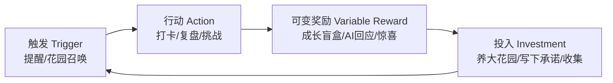
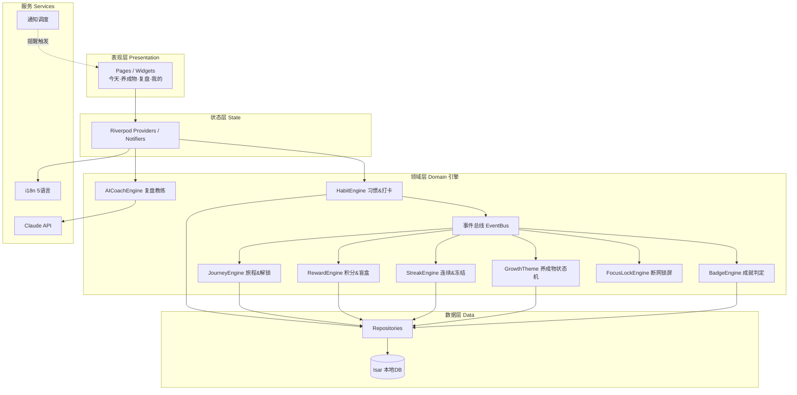
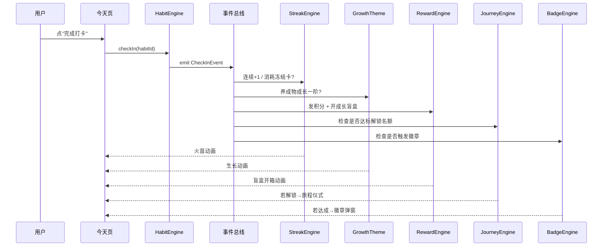

# 习惯养成 App —— 成瘾机制 & 软件架构设计 v0.1

> 本文档专注**行为机制 + 软件架构**,美术延后。
> 技术栈:Flutter + Riverpod(状态) + Isar(本地DB) + 事件驱动领域层。

---

## 〇、设计底线(先立规矩)

**核心悖论**:App 教人夺回注意力(断网、深度思考、管理信息),却又要用成瘾机制留住人。若处理不好,产品会背叛自己的价值观。

**设计底线:让用户对"完成习惯"上瘾,而不是对"停留在 App 里"上瘾。**

| 我们用 | 我们拒绝 |
|---|---|
| 奖励绑定"行为达成"(打卡即得) | 奖励绑定"停留时长" |
| 完成今日即可关闭,鼓励用完即走 | 无限下拉 feed、杀时间内容 |
| 精准、克制的提醒(对的时间一条) | 通知轰炸、制造焦虑 |
| 变量奖励用在"庆祝坚持" | 老虎机式空耗 |

> 这条底线本身也是差异化和信任资产——用户会感到"这个App真的为我好"。

---

## 一、12 习惯的章节化(渐进解锁)

放弃"12个全摆出来选"(选择过载),改为 **3 章 × 4 习惯,分章解锁**。可见但锁住的习惯 = 制造期待(蔡格尼克效应:未完成的东西最抓人)。

| 章节 | 主题 | 4 个习惯 | 难度/周期 |
|---|---|---|---|
| **第一章 觉察·内功** | 每天、独处、低门槛 | ①100字复盘 ③30分深度思考 ⑥每日微不适 ⑨睡前断网 | 每日高频,最易起步 |
| **第二章 管理·掌控** | 向外、管理、需面对他人 | ②每周联系一人 ⑦信息清洗 ⑧财务盘点 ⑪学会说不 | 周期/难度上升 |
| **第三章 精进·成长** | 长期、精神、低频 | ④知识输出 ⑤跨界读书 ⑩一个人旅行 ⑫冷酷真话 | 长周期,最深 |

**分章逻辑**:内功 → 管理 → 精进,难度和周期递增。第一章正好覆盖 文本/计时/挑战/提醒 四类交互引擎(= 技术上的 MVP)。

> 注:章节解锁的具体旅程化设计(成就→能量→自选下一站)见 `03_叙事化世界观_草案.md`,那是本章的升级版。

---

## 二、成瘾 / 正反馈机制清单(小心思)

用 **Hook 模型**(触发→行动→可变奖励→投入)当骨架,挂上 12 个具体机制。



### 机制 1:可变奖励 · 成长盲盒(成瘾核心)
打卡后不是固定+10分,而是开一个"成长盲盒":随机掉落养料/装饰/稀有种子/双倍积分/暖心文案。**不确定性 = 老虎机原理**,但奖励只在"已完成行为"后出现——合规底线。

### 机制 2:目标梯度进度条
到处显示"再 2 天开花""章节进度 3/4""距离解锁下一站还差 1 个习惯"。**越接近目标越努力**(goal-gradient effect)。永远让用户看到"就差一点点"。

### 机制 3:火苗 Streak + 冻结卡(损失厌恶)
每习惯一条连续记录。**人对"失去连续"的痛 > 得到的爽**。给每月 1–2 张冻结卡防一次断更全毁,断更进休眠可浇水复活——痛感留着(驱动),绝望去掉(防弃用)。

### 机制 4:每日惊喜 · 登录即变
每天打开有随机小事件:天气影响生态光影、随机暖心语/毒鸡汤(5语言)、限时"今日额外挑战"(完成得稀有奖励)。**每天不一样 → 天天想看一眼**。

### 机制 5:收集册(收集欲 + 完成度强迫)
植物/星球图鉴 + 徽章册 + 装饰收藏,带"已收集 18/40"进度。**收集癖 + 完形强迫**(差几个没集齐的难受感)。

### 机制 6:里程碑仪式感
首次开花、连续30天、解锁新章、习惯毕业……都有隆重全屏动画 + 可分享成就卡。**峰值体验 + 社交传播**双收。

### 机制 7:即时微反馈
每次点击/打卡有即时视觉 + 触觉反馈(haptic)+ 微音效。**多巴胺来自即时反馈**,延迟一秒都掉体验。

### 机制 8:承诺锚点(自我一致性)
Onboarding 让用户写下"我为什么要养成这个习惯"。动摇/想放弃时回放这句话。**承诺一致性原理** + 情感召回。

### 机制 9:AI 教练可变回应(个性化 + 不可预测)
每次复盘,AI 给一段**独一无二**的回应/追问/鼓励。既是可变奖励,又是个性化投入。让用户觉得"它懂我"。(用 Claude API)

### 机制 10:养成护城河(沉没成本)
养成物越养越大越美,离开的心理成本越高。**禀赋效应 + 沉没成本**。养了60天的繁茂花园/星系,舍不得让它荒。

### 机制 11:人生回报率仪表盘(呼应主题)
把坚持换算成"复利可视化":一个仪表盘显示"你已积累的人生回报率",呼应文案"回报率最高的习惯"。**长期主义的具象化反馈**。

### 机制 12:社会认同(二期)
好友花园串门、读书分享圈、匿名排行榜(连续榜/复盘榜)。**社会证明 + 适度攀比**。二期上,MVP 先不做(避免过早引入社交压力)。

---

## 三、软件架构(Flutter,事件驱动)

核心思想:**一次打卡,广播一个事件,各个引擎独立响应。** 这样加新机制(新徽章、新奖励规则)不动核心代码。

### 分层架构



### 事件驱动:一次打卡发生了什么



> 优势:每个引擎单一职责、可独立测试;新机制只需新增一个订阅者;打卡这个核心动作永远不用改。**这是让"多加小心思"不失控的架构保证。**

### 推荐技术选型

| 关注点 | 选型 | 理由 |
|---|---|---|
| 状态管理 | **Riverpod** | 现代、可测、编译期安全,新手+AI协作友好 |
| 本地数据库 | **Isar** | 快、支持复杂查询、Flutter原生、适合离线优先 |
| 事件总线 | 轻量自建 / Riverpod stream | 领域事件解耦 |
| 通知 | flutter_local_notifications | 本地定时提醒/就寝模式 |
| 动画 | Flutter 内建 + Rive(二期) | 生长、开箱动效 |
| 国际化 | flutter intl + arb ×5 | 复用 12-habits-localized |
| AI 教练 | Claude API | 复盘可变回应 + 自输入目的地剧情生成 |

---

## 四、机制 → 数据模型补充

在 `01_产品设计_MVP.md` 的模型基础上,机制新增/扩展字段:

```
Habit
  + chapterId(1|2|3), unlocked(bool), commitmentNote(承诺锚点)

Chapter
  - id, titleKey, unlockCondition, unlocked, unlockedAt

RewardLog          // 可变奖励记录
  - id, date, type(xp|decoration|rareSeed|double), source

Collection         // 收集册
  - itemId, type(plant|badge|decoration), obtained(bool), obtainedAt

DailyEvent         // 每日惊喜
  - date, type, payload, claimed

LifetimeReturn     // 人生回报率仪表盘
  - totalDays, totalCheckins, computedScore
```

事件驱动下,这些表大多由"引擎响应事件"写入,UI 只读。

---

## 五、已确认结论

1. **章节分组**(内功/管理/精进 3×4)✅
2. **解锁**:升级为旅程化"成就→能量→自选下一站"(见 `03`)✅
3. **设计红线**(对"完成"上瘾而非"停留"上瘾)= 产品红线 ✅
4. **12条成瘾机制**:MVP 先做 盲盒/进度条/火苗+冻结卡/里程碑/即时反馈/承诺锚点;AI回应、收集册、仪表盘、社交 分批后续。

**下一步**:并入 P1 开发任务清单(先实现哪些引擎、先做哪几个习惯站点)。
