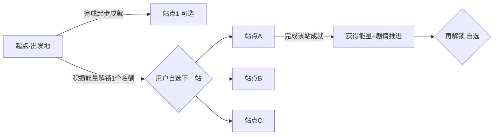

# 习惯养成 App —— 叙事化世界观(旅程/飞行器)草案 v0.2

> 核心:把零散机制升级为"一段有剧情的自我探索之旅"。美术延后;本文只谈世界观骨架 + 机制统合 + 与多地区的结合。

---

## 一、方向(对齐想法)

- **飞行器 = 旅程隐喻**:用户是旅人,驾驶飞行器探索。坚持习惯 = 燃料/能量。
- **成就 → 积分/能量 → 解锁**:完成一个习惯的几个**成就(里程碑)**得能量,攒够点亮航线,解锁下一站。
- **用户自己选**:解锁的是"资格/名额",飞向哪由用户挑(自主权 → 更强内在动机)。
- **剧情链接**:一条贯穿叙事,把解锁、奖励、各地区串成整体,不再是散装机制。

---

## 二、统合方案:旅程为骨,统一一切

一句话:**旅程是宏观主线(解锁+剧情),养成物是微观日常(每日养成),两者不冲突、互相喂养。**

```
        ┌─────────── 旅程主线(飞行器) ───────────┐
        │  世界地图 · 航线 · 目的地 · 剧情推进        │
        │  能量驱动解锁,用户自选下一站                │
        └───────────────┬────────────────────────┘
                        │ 每日坚持产出"能量"
        ┌───────────────┴────────────────────────┐
        │  养成物(每站一片):日常打卡的养成可视化     │
        └─────────────────────────────────────────┘
```

- **飞行器/旅程**:负责"我走了多远、下一步去哪、故事讲到哪"——长期方向感和期待。
- **养成物**:负责"我今天有没有坚持"——每日即时反馈。
- **联系**:每日坚持 → 产出能量 → 推动飞行器 → 到新站 → 开垦一片新生态 → 继续养。闭环。

---

## 三、旅程结构

### 世界地图
一张地图,散布若干**目的地(站点)**。每个站点 = 一个习惯的修炼地,同时对应一个**真实地区**(见第四节)。

### 航线与解锁



- 不再"章节强制顺序",改为:**攒够能量 → 解锁 N 个名额 → 用户从可选池自己挑**。
- 保留一点引导:起点先开放第一章那批"低门槛内功习惯",避免新手一上来选到最难的(⑩旅行/⑫冷酷真话)受挫。可选池随进度扩大。

### 成就系统("打成几个成就")
每个习惯站点有一条**成就阶梯**,例:

| 成就 | 条件 | 奖励 |
|---|---|---|
| 启程 | 首次打卡 | 能量 + 剧情开场 |
| 扎根 | 连续3天 | 能量 + 养成物发芽 |
| 稳航 | 连续7天 | 能量 + 解锁装饰 |
| 抵达 | 连续21天 | 大能量 + 该站剧情高潮 + 徽章 |
| 心流 | 连续60天 | 站点"点亮/毕业" + 稀有收藏 |

- 成就 = 明确小目标(goal-gradient),每一步都"就差一点"。
- 能量是硬通货:解锁新站、升级飞行器、兑换收藏。

---

## 四、与多地区本地化的结合(关键创新)

**地图上的"地区" = 已本地化的真实地点。** 一举两得。

| 站点主题 | 简体版 | 日文版 | 英文版 | 西语版 |
|---|---|---|---|---|
| 习惯⑩ 一个人的旅行 | 云南深山 | 奈良の山奥 | Montana 山区 | la Patagonia |
| (其他站点同理在地化) | … | … | … | … |

- **不同语言版本,飞行器飞过的目的地和剧情场景都不同**——本地用户看到熟悉的地方,代入感强。
- 剧情文本走 i18n key,场景美术可做"地区皮肤"(后期)。
- 这把原来"只是翻译文案"的多地区,升级成"**每个地区一套在地旅程**",是很强的差异化和情感钩子。

---

## 五、剧情如何写(轻量可行)

- 每个站点一段**微剧情**:抵达时一段旅人独白/顿悟,内核 = 该习惯的文案智慧 + 该地区的在地气质。
  - 例:飞抵"奈良の山奥"(习惯⑩),剧情 = 深山独处、跟真实的自己兑现(呼应文案原句)。
- 贯穿线:一个"为什么出发"的开场(呼应 onboarding 承诺锚点)→ 沿途每站顿悟 → 终点"旅程大成/看清自己"。

---

## 六、养成物的去留

不砍,**降级为"每站的生态"**:飞行器到一个新站 → 开垦一片属于该习惯的小生态,日常打卡养它。旅程走完,地图上是一串你亲手养绿的站点。养成物的"休眠+浇水复活"逻辑不变。

---

## 七、对开发/MVP 的影响(诚实)

- 叙事化让产品更有灵魂、更强差异化,但**内容量和美术量都上升**。
- 应对:**分期**。MVP 先做机制骨架——成就阶梯 + 能量 + 自选解锁 + 文本剧情 + 简易地图;飞行器动画、地区场景、养成物美术全部后期迭代。
- 架构不变:上一份的**事件驱动引擎**完全支持——新增 `JourneyEngine`(管地图/航线/解锁名额)和 `AchievementEngine`(成就判定),订阅同样的打卡事件即可。不推翻已有设计。

---

## 八、已确认方向与调整(v0.2)

### 确认
1. 主题 = **旅程主线 + 每站养成物(融合)** ✅
2. 地区 = **本地化真实地点**思路 ✅
3. 视觉叙事是**核心体验目标** ✅

### 三个关键调整(按反馈)

**调整1:每站养成物不锁死花园 → 可换主题的"生态容器",用户自选**
- 抽象成一个 `GrowthTheme` 接口:花园 / 星球星系 / 技能树 / 火苗… 都是它的实现皮肤。
- 后续陆续上线,用户按喜好挑(有人爱花园治愈、有人爱星球科技感、有人爱技能树成就感)。个人化 = 更强代入。
- 架构上**养成逻辑(阶段/能量/休眠复活)与呈现皮肤解耦**;加新皮不改核心。
- MVP 先做 1 种(建议花园,最治愈易起步),接口预留。

**调整2:目的地 = 在地化推荐 + 用户自己输入(重点亮点)**
- 系统按地区给推荐默认(云南/奈良/Montana/Patagonia…),但用户可**输入自己心中有意义的真实地点**(老家、梦想之地、西藏、冰岛…)。
- 呼应习惯⑩"一个人的旅行"——目的地本就该是个人选择,自输入让旅程真正属于用户。
- **AI 在这里是关键**:用户自输入的地点没有预写剧情 → 调 Claude API **实时生成一段在地顿悟微剧情**(结合该地点气质 + 该习惯智慧)。别的打卡App做不到,强差异化。
- 兜底:无网络/AI不可用时,退回通用旅程剧情模板。

**调整3:剧情 = 文本 + 视觉都要,视觉是重点,但执行分期**
- 视觉叙事纳入核心体验目标(不做成简陋纯文字)。
- 落地节奏:先立**叙事结构 + 交互骨架 + 文本剧情**(能跑、能验证故事打不打动人),视觉/动画**紧接着分层加上**——而不是第一行代码就做过场动画,否则 MVP 会难产。
- 一句话:**骨架先行、视觉快速跟进、逐帧变精**。既保住视觉品质目标,又不让新手项目卡死。

### 对架构的影响
- 新增 `JourneyEngine`(地图/航线/解锁名额/自输入目的地)、`AchievementEngine`(成就阶梯)、`NarrativeService`(剧情:预设 + AI生成)。
- 养成呈现抽象为 `GrowthTheme`(可换皮)。
- 全部订阅同一打卡事件,不推翻事件驱动架构。

### 下一步
并入正式设计,收敛 **P1 开发任务清单**(先实现哪些引擎、先上哪套皮、先做哪几个习惯站点)。
